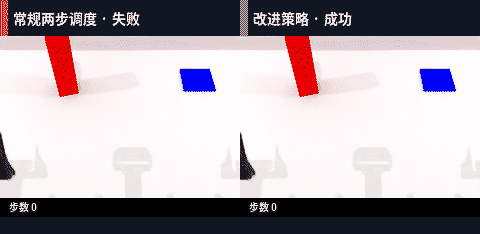
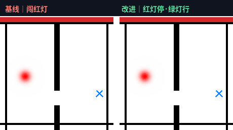

# Rwxzxy

具身智能 · 机器人策略 · 世界模型

[联系邮箱](mailto:2728836780@qq.com) · [GitHub](https://github.com/Rwxzxy)

## 项目展示

### 机器人策略推理｜RoboTwin · SmolVLA

同一任务、同一初始条件：基线未完成交接，改进策略完成任务。196 个配对评估回合中，改进策略成功 **111 次**，均匀两步基线成功 **96 次**。

### PRISM｜信号灯任务中的世界模型

同一环境种子：基线在红灯时继续前进，改进模型会停车并在绿灯时通行。闭环成功率 **72.0%**，标准训练基线为 **35.4%**；强对照为 **73.1%**。

---

项目代码与完整实验记录暂未公开。可通过邮箱联系，获取项目介绍或演示。
