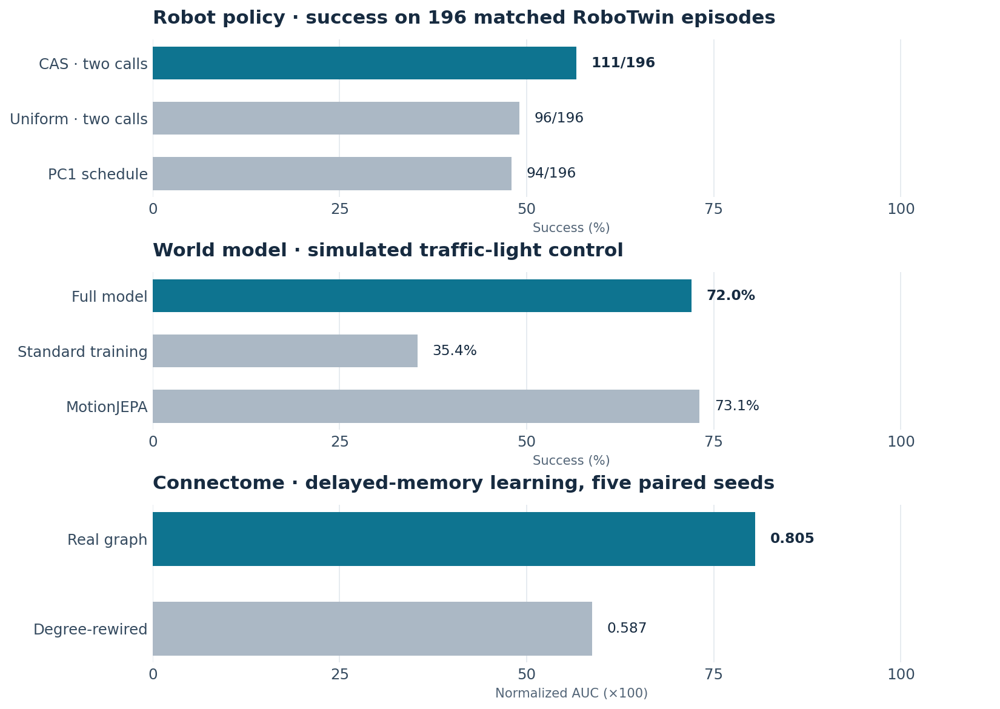

# Rwxzxy

Research projects in **robot learning, world models, and generative AI**.

[Email](mailto:2728836780@qq.com) · [GitHub](https://github.com/Rwxzxy)

## Selected work

Separate internal evaluations; results across panels are not directly comparable. Research repositories are private while work is in progress.

- **Few-step robot-policy inference.** On matched RoboTwin episodes, a frozen SmolVLA policy succeeded in **111/196** episodes with two inference calls, versus **96/196** with uniform two-call sampling. The same comparison included a fixed PC1 schedule at **94/196**.
- **Predictive representations for control.** In a simulated traffic-light task, control success rose from **35.4%** with standard training to **72.0%**; a separate comparator reached **73.1%**.
- **Connectome architecture for memory.** In a five-seed delayed-memory test, the real graph reached **0.805** normalized learning AUC versus **0.587** for a degree-preserving rewired graph. This is a task-specific preliminary result.
- **Image-generation dynamics.** In FLUX.1-dev, changing the prompt stopped changing color–object binding after roughly **4/28** steps, while later states remained sensitive to controlled edits.
- **Image-to-image prototypes.** Visual comparison experiments on surgical-video frames; no benchmark claim yet.

**Contact:** [2728836780@qq.com](mailto:2728836780@qq.com). Brief technical summaries or demos are available on request.
