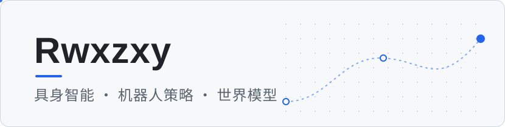
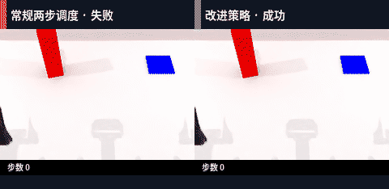
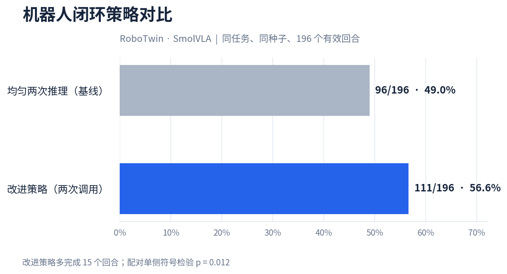
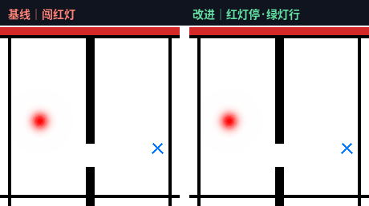
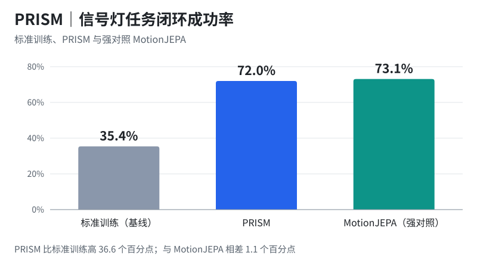

<picture>
  <source media="(prefers-color-scheme: dark)" srcset="assets/banner-dark.svg">
  <source media="(prefers-color-scheme: light)" srcset="assets/banner-light.svg">
  
</picture>

## 研究方向

- **具身智能**：在 RoboTwin 仿真中做闭环评估，用同任务、同初始条件的配对回合比较不同策略。
- **机器人策略**：改进 SmolVLA 策略的推理调度方式，提升闭环任务成功率。
- **世界模型**：研究世界模型的训练方式（PRISM），让在其上训练的策略在信号灯任务中红灯停车、绿灯通行。

## 项目展示

<table>
<tr>
<td>

### 机器人策略推理｜RoboTwin · SmolVLA

<b>111 / 196</b> 改进策略 &nbsp;vs&nbsp; <b>96 / 196</b> 均匀两步基线 &nbsp;·&nbsp; 配对评估回合

同一任务、同一初始条件：基线未完成交接，改进策略完成任务。196 个配对评估回合中，改进策略成功 **111 次**，均匀两步基线成功 **96 次**。

查看结果图

 

</td>
</tr>
</table>

<table>
<tr>
<td>

### PRISM｜信号灯任务中的世界模型

<b>72.0%</b> PRISM &nbsp;vs&nbsp; <b>35.4%</b> 标准训练 &nbsp;·&nbsp; 强对照 MotionJEPA <b>73.1%</b>

同一环境种子下，基线闯红灯，PRISM 红灯停车、绿灯通行。结果汇总自 **3 个世界模型种子 × 3 个策略训练种子**：成功率 **72.0%**，标准训练基线 **35.4%**；强对照 **MotionJEPA 为 73.1%**，高出 1.1 个百分点。

查看结果图

 
<picture>
  <source media="(prefers-color-scheme: dark)" srcset="assets/prism_results-dark.svg">
  <source media="(prefers-color-scheme: light)" srcset="assets/prism_results-light.svg">
  
</picture>

</td>
</tr>
</table>

## 技术栈

---

项目代码与完整实验记录暂未公开。可通过邮箱联系，获取项目介绍或演示。
